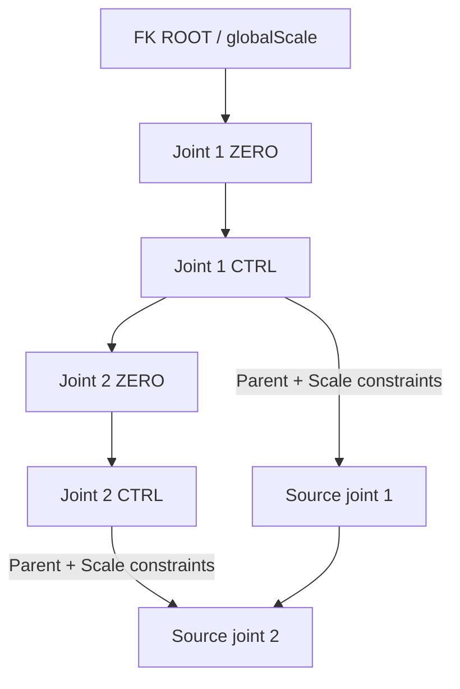

# Modular Rig — Root, FK, IK/FK and Foot setup guide

## Revision 2.37 — constraint organization and per-module actions

All new native constraints use the shared `constraintNode` transform. Each
module that needs constraints has its own owned subgroup inside it. The shared
container is not a module member. Matrix-only Root/Foot modules do not create
empty constraint subgroups. Source joint parents and solver connections stay
intact. Math nodes such as multMatrix retain their existing organization.

In **Scene modules**, use the **Constraints**, **Mirror** or **Delete Rig** button
beside the intended module. Constraints can organize older saved FK/IK modules
without rebuilding them. Mirror uses the common Search / Replace fields below
the table and existing counterpart joints. It supports FK, IK, IK/FK, Foot and
Root modules bound to a side-specific joint; placement-only Roots stay shared.

Delete Rig removes only that module's owned solvers and subgroup, retains the
source joints' current pose, and leaves other modules intact. Move foreign
children or disconnect external users from the owned subgroup before removing
it. A reused user-created constraintNode is retained. A tool-created shared
container is pruned only when empty and unused. See
[Constraint_Groups_Guide.md](Constraint_Groups_Guide.md) for workflow and native
Maya verification.

## Revision 2.34 — Root and Foot

Root and Foot are now implemented, independent modules in this tab. Root uses
Main_ctrl > Root_ctrl with globalScale on Main. Foot supports IK reverse pivots
and ankle/ball FK, optional Root attachment, joint-based/custom names, saved
defaults, Foot mirroring and current-pose removal. Drive ankle off leaves an
existing leg driver intact and exposes a foot ankle target for attachment.
See [Root_Foot_Modules_Guide.md](Root_Foot_Modules_Guide.md) for the full workflow.

The following sections retain the established FK/IK architecture and historical
revision notes. Root and Foot add no runtime Python or external rig plug-in.

Master Rigging Toolkit 2.24. FK, Three-Bone IK and IK/FK are implemented modules. Each build has
its own root, controls, constraints and metadata. You can build multiple modules
on separate joint trees and manage them independently in the **Modular Rig** tab.

## Revision 2.24 — solver frames and removal

New Three-Bone IK and IK/FK rigs own three solver joints whose +X axes aim at
the next joint. Their rest translations are `(upperLength, 0, 0)` and
`(lowerLength, 0, 0)`. Length factors multiply default translateX only;
solver scale stays `(1, 1, 1)`. Two locator buffers under the first two solver
joints and a tip transform retain the original source orientation offsets.
Locator localScale controls their display size only.

Source outputs use offsetParentMatrix with bind-local compensation, original
bind world scale, the solved/blended rigid pose, ROOT world matrix and the
actual DAG parent's inverse world matrix. They do not read the source joint's
live matrix/inverseMatrix or parentInverseMatrix. SSC compensation reads its
upstream inverseScale input, preserving the original JO/RA/SSC definitions.
IK BASE scale is filtered. ROOT.globalScale is the uniform scale control.

Removal snapshots evaluated source offsetParentMatrix, deletes owned graph
nodes and stores those matrices as static offsets root-first. It verifies
world pose and retains local TRS, jointOrient, rotateAxis and SSC. This keeps
the current pose; it does not bake animation or reset offsetParentMatrix to
identity. Foreign source animation connections remain connected.

Saved older modules retain their original backend. Remove with pose preservation
and rebuild for this architecture. The legacy length-controls upgrade does not
convert the solver or blend graph, and rebuilding does not migrate animation.
Later revision-labelled sections describe historical implementations; the
v2.24 solver and blend descriptions above take precedence for new builds.

## IK/FK blend module

1. Expand **IK/FK blend module** in **Modular Rig**. It starts collapsed.
2. Get First, Second and Third consecutive joints with the individual pickers,
   or **Get chain from selected first joint**. A straight chain needs an initial
   slight bend, just like the standalone IK builder.
3. Set module name, control size and pole distance. **Load all IK/FK controller
   name fields** provides ROOT, END, POLE, IK BASE and three FK overrides.
   Blank names use joint-based defaults.
4. Validate, then **Build IK/FK module**. The manager selects the new rig.
5. Select ROOT to animate **ikFkBlend**, or use the section's **Load blend** /
   **Apply blend** controls. Select module controls for all six animator controls.

The input chain must be undriven and pass the existing build validation. Older
standalone FK/IK modules remain separate; there is no conversion action. Remove
the earlier module while keeping its current pose before building IK/FK on the
same joints. Build is one Undo step and source-pose validation rolls back a failure.

| ROOT `ikFkBlend` | Output | Visible controls |
| --- | --- | --- |
| 0 (default) | FK | Three FK controls |
| Between 0 and 1 | Weighted FK/IK | FK plus IK BASE, END and POLE |
| 1 | IK | IK BASE, END and POLE |

The blend is unlocked/keyable with a native 0–1 clamp. New builds use rigid
branch matrices in unscaled ROOT space, derive child poses relative to each
branch parent, blend local rotations with quaternion interpolation, and rebuild
the result root-first. Each segment uses the explicit length
`L(w) = (1-w) * L_FK + w * L_IK`. Thus equal branch lengths remain constant;
stretched IK lengths interpolate to FK lengths without world-position chord
shortening. There are no source parent/scale constraint weights in new builds.
For exactly opposing local translation directions, a nonzero IK direction is
used at the singular midpoint; arbitrary opposed vectors may change direction
abruptly there rather than collapse the bone.

### Controls and evaluation

The three FK controls form a hierarchy beneath ROOT/FK_CONTROLS. Their ZERO
groups copy each source joint's bind world frame, including positive uniform
scale, while controller rotation orders follow the joints. An IK BASE control
positions/orients the internal IK driver group. END drives the goal and end
orientation; POLE controls the bend plane. The IK branch includes all six
translation-based length controls and its two END length readouts.

ROOT.globalScale scales both branches and their controls. Runtime start/END/POLE
measurements use their control matrices in ROOT space. The start follows IK BASE,
without reading the solved driver chain's matrices and creating a feedback loop.
There is one IK driver skeleton; FK control matrices feed the local pose blend directly.
Source hierarchy, jointOrient, rotateAxis, inverseScale and SSC definitions are
retained. Length features still use joint translation, not bone scale.

### Match and switch

**Apply blend** changes the weight only. Unmatched branches can describe
different poses, so moving the blend naturally moves the joints between them.
Use **Match & switch to FK** or **Match & switch to IK** to preserve this frame's
current output pose before changing modes.

The action snapshots all three source world matrices before changing controls.
For FK, it matches full controller world frames root-first, including translation
needed to retain a stretched IK pose. For IK, it matches BASE and END position /
orientation, calculates POLE from the current bend plane, and sets upper/lower
length adjustments from the measured segment lengths. It sets stretch to 1 and
antiPop/slide/poleLock to 0 to reproduce the sampled reach. Current rest lengths
define the slider ratios. Straight poses retain the current POLE side where the
first/end span and existing pole direction are usable.

Maya decomposes each desired control matrix using its actual parent, rotation
order and pivot settings. Controls and blend inputs are preflighted before any
writes. Locked/referenced controls, driven keys or foreign inputs stop matching;
direct time curves are supported with keying enabled. Temporary decomposition
transforms are deleted within the Undo action and are not persistent rig nodes.

After switching, the action verifies complete source world matrices and
orientation definitions. An RP solver cannot represent every arbitrary FK twist,
per-control scale, collapsed limb or out-of-range length pose. A mismatch causes
rollback of all control/length/blend writes rather than accepting a pose jump.
Use ROOT for supported uniform module scaling. Matching does not edit source
joints or their orientation definitions directly.

**Key matched controls / blend on current frame** creates/updates keys for all
destination TRS channels, relevant IK length controls and the blend. Existing
direct time curves are retained. Key values are reevaluated before pose checking.
The action keys only the current frame; it does not bake a range, add previous
frame keys, or change blend tangents to Step. Set animation keys/tangents for the
transition you want; a smoothly keyed blend will interpolate between keyframes.

### Defaults, names, mirror and removal

Names come from the supplied joints, e.g. `hip_L_IKFK_ROOT`,
`hip_L_IK_BASE_CTRL`, `hip_L_FK_CTRL`, `knee_L_FK_CTRL`,
`ankle_L_FK_CTRL`, `ankle_L_IK_END_CTRL`, `knee_L_IK_POLE_CTRL`.
The shared manager can rename all seven controls, store defaults and mirror the
complete module. Mirroring reuses size/pole distance on existing counterpart
joints, maps FK role UUIDs and custom names, and builds a neutral FK-default rig.
It does not copy animation, posed lengths or the current blend.

Go to Default includes FK, BASE, END/POLE and length-control values. It also
restores the saved blend when **Include ROOT / globalScale** is off; ROOT
placement/globalScale are kept in that case. Store current as default explicitly
captures the current blend as well. Removal uses the shared UUID ownership and
current-pose protection for both branches, constraints, length/blend graph,
automatic unit conversions and metadata. All source joints remain.

```python
rig = toolkit.build_ikfk_module("hip_L_JNT", "knee_L_JNT", "ankle_L_JNT",
                              name="leg_L", control_size=1, pole_distance=1)
toolkit.set_ikfk_blend(rig["module"], 0.5)     # blend only
toolkit.switch_ikfk(rig["module"], "IK")      # match, switch and verify this pose
toolkit.switch_ikfk(rig["module"], "FK", keyframe=True)
```

Native Maya/Qt validation and performance benchmarking have not been run here.
The local suite includes matrix arithmetic, quaternion blending, equal and
unequal segment lengths, unit/global-scale behavior, ownership and rollback;
it does not reproduce native RP solving or Maya joint/Euler decomposition.
Run `maya_smoke_test.run_modular_xik()` inside Maya for the current backend and
`run_modular_ikfk()` for matching, keying and module management.

## Translation-based IK lengths (revision 2.22)

New Three-Bone IK modules have these unlocked, keyable END_CTRL attributes:

| Control | Range / default | Behavior |
| --- | --- | --- |
| `stretch` | 0–1 / 0 | Extend-only automatic stretch; 1 reaches END beyond rest length. |
| `antiPop` | 0–1 / 0 | Soft IK near straight extension; 1 creates a 20% soft zone. |
| `upperSlide` | −0.95–10 / 0 | Adjust upper rest length by a fraction; 0.1 = +10%, −0.1 = −10%. |
| `lowerSlide` | −0.95–10 / 0 | Adjust lower rest length independently by the same convention. |
| `slide` | −1–1 / 0 | Redistribute manual total length; positive moves length from lower to upper. |
| `poleLock` | 0–1 / 0 | Blend into start→POLE and POLE→END lengths; 1 pins the middle joint to POLE. |

Select a rig in **Scene modules**. In the IK section's **Selected IK · length
controls (translation)** box, **Load values**, edit, then **Apply values**.
**Key values on current frame** supports direct time animation and preserves
existing curves. **Select END attributes** selects END for the Channel Box;
you can animate or use driven keys on its unlocked controls there.

`upperLength` and `lowerLength` are connected Channel Box readouts. They report
physical bone lengths in ROOT's unscaled space, displayed in Maya's current
linear units. The controls/readouts are not explicitly locked. Readouts already
have incoming connections; use them as drivers by connecting their outputs.

Length changes multiply each child driver joint's original signed translate
XYZ vector. This supports bones aimed along arbitrary local axes, including
negative translations. No length feature connects to joint scale. Existing
ROOT.globalScale and source scale constraints still provide uniform module
scaling. The runtime graph measures END and POLE in ROOT space, so global scale
does not trigger additional stretch. It does not read solved driver matrices
at runtime. The start point is sampled in ROOT space at build/upgrade time.

### Soft reach, length order and pole lock

Upper/lower slide first adjust the two rest lengths. Overall slide transfers
length between them while keeping that adjusted total constant. A small minimum
length avoids zero-length bones. Automatic stretch then multiplies both lengths
by the same factor; it extends rather than automatically shortening bones.

For total length `T`, distance to END `D`, and soft zone
`z = antiPop × 0.2 × T`, the goal radius is `D` below `T − z`; beyond that it is
`T − z × exp(−(D − (T − z))/z)`. With antiPop zero, the goal stops at total length.
The stretch factor blends from 1 to `max(1, D / softGoalRadius)`. With full
stretch, the goal reaches END even when soft reach is active, while the extra
length retains a bend near extension. Anti-pop alone intentionally lets the
tip lag END near full extension. It smooths extension; Maya's RP solver still
governs folded/straight singularities and physically unreachable manual lengths.

Pole lock is applied last. Full lock replaces lengths with start→POLE and
POLE→END distances and restores the goal to END. The middle joint reaches POLE
for a nondegenerate triangle. Partial lock blends those lengths and the goal.
Coincident points are clamped to a tiny positive length; a straight pole triangle
still has an undefined bend plane.

### Existing rigs, defaults, mirror and removal

Older IK rigs keep their original graph until **Add length features to selected
older IK** is clicked. The upgrade adds the controls/graph, reparents the owned
handle beneath an owned soft-goal transform, registers all new ownership, and
verifies the source joints retain their current world pose. It is one Undo
action and rolls back on failure. Locked/driven bone translations or conflicting
custom END attributes stop it before changes. Repeating it is harmless.

Go to Default restores the six saved length controls as well as END/POLE TRS.
Store current as default captures their current values. Upgrading a rig with
stored defaults appends neutral length values while preserving the old defaults.
Mirroring builds a new neutral length system on the counterpart joints; it
does not copy posed slider values or animation. Removal deletes the owned
length nodes, soft goal and automatic unit conversions along with the original
IK system, keeping the current evaluated source joint pose.

The graph uses native matrix, distance and arithmetic nodes, with no expressions,
timers or Python per-frame callbacks. A zero-anchor fixture adds 57 graph nodes
to the original 23-node module, before Maya's automatic unit conversions; other
start offsets need additional goal-position math. These are graph counts,
not measured performance. Native evaluation and benchmarking are pending.

```python
toolkit.set_ik_length_controls(rig["module"], {
    "stretch": 1.0, "antiPop": 0.5,
    "upperSlide": 0.1, "lowerSlide": 0.0,
    "slide": 0.2, "poleLock": 0.0})
# Older saved modular IK:
toolkit.enable_ik_length_features(module)
```

**329 local tests pass**, including numerical evaluation of the generated graph,
signed translations, global-scale invariance, unit-conversion ownership,
default/key behavior, legacy upgrades, rollback and pose-preserving removal.
The local command fake does not simulate IK. Run
`maya_smoke_test.run_modular_ik_lengths()` inside Maya to check actual stretch,
soft reach, manual lengths, slide, pole lock, scales, linear-unit changes and
removal/Undo/Redo. Native Maya/Qt checks have not been run here.

## Compact section layout (revision 2.21)

Collapsed FK, Three-Bone IK and Scene modules sections now occupy compact
arrow-header rows. Click anywhere on a header to expand its body. The normal
group-box title padding is removed; hidden fields do not retain layout space.
Groups use consistent body margins, an 8-pixel gap and top alignment. The page
background matches the toolkit's dark theme. Expanded fields and all scene rig
functions remain the same. Native Maya/Qt visual verification is pending.

## Controller naming, default pose and mirror (revision 2.20)

All actions below support both FK and Three-Bone IK. Existing module ownership
metadata stays compatible; replacing the script does not rebuild scene rigs.

### Joint-based and custom names

New controllers use the supplied joint names and preserve namespaces. Common
joint suffixes `_JNT`, `_jnt`, `_joint`, `_Joint` are removed before adding the
controller role. Examples:

| Input / role | Automatic controller name |
| --- | --- |
| `upper_L_JNT` / FK root | `upper_L_FK_ROOT` |
| `upper_L_JNT` / FK control | `upper_L_FK_CTRL` |
| `ankle_L_JNT` / IK end | `ankle_L_IK_END_CTRL` |
| `knee_L_JNT` / IK pole | `knee_L_IK_POLE_CTRL` |

Controller names no longer contain the module type twice or a random UUID
fragment. UUIDs remain in metadata for ownership. Existing-name collisions get
Maya's numeric suffix for automatic names; repeated joint leaf names receive
readable numeric suffixes. Explicit custom names must be valid Maya names,
unique within the module, and unused by another object. Any namespace must
already exist. The Module name field labels the module; it does not force a
prefix onto every controller.

In either builder, click **Load controller name fields from joints** (FK) or
**Load ROOT / END / POLE name fields** (IK). Enable **Use custom controller
names**, then enter overrides. FK has ROOT plus a field for each joint control;
IK has ROOT, END and POLE fields. Blank fields retain automatic names. Validate
and Build refresh the list against the current joint inputs.

To improve names on an existing rig, choose it in **Scene modules**, click
**Load selected rig name fields**, enter custom names if wanted, then **Apply
controller names**. Leave the fields blank, or disable custom naming, to use
joint-based names. This renames ROOT and animator controls while retaining their
UUIDs, connections, values and saved default pose. It does not rebuild the rig
or rename the source joints. Naming is one Undo action with rollback on failure.

### Go to Default

New modules save the initial local values of ROOT and their animator controls.
Select the module and click **Go to Default**. FK controllers or IK END/POLE
return to those saved values. **Include ROOT / globalScale** defaults off, so
module placement and current global scale remain unchanged. Enable it to also
restore the saved ROOT translation/rotation/globalScale. Root scale XYZ remains
connected to globalScale; the action does not disconnect those inputs.

**Store current as default** explicitly replaces the saved default with current
local ROOT/control values. Use it after attaching/reparenting ROOT if the new
local placement should become its default. Saved translation/rotation values
include Maya unit settings and are converted when restoring in different
linear/angular units. This stores values, not animation or a skeleton bind pose.

**Key default on current frame** creates/updates keys instead of setting plain
values. Direct time animation curves are supported; they are retained. With
that option off, animated channels stop the action. Locked channels, driven-key
curves and other incoming drivers also stop it before any values are changed.
IK length controls are included; other custom weights and source joint attributes
are not reset. Reset is one Undo
step and failures roll back the whole reset.

Modules from 2.18/2.19 have no saved default metadata. They can reset their
animator controls to the original zero T/R, unit S values with ROOT excluded.
To include ROOT, first use **Store current as default** at the desired pose,
or rebuild the module. A ROOT reparented after building still restores saved
local values; store a new default when the new attachment should define them.

### Mirror Rig

Choose the source module in **Scene modules**. Set **Mirror Search / Replace**
(default `_L` / `_R`), use **Swap** for the reverse direction, then **Preview
mirror joints**. **Mirror rig to matching joints** builds the same module type
on the existing counterpart joints and selects the new module in the manager.

Counterparts must exist, be unambiguous in the same namespace, preserve the
joint-tree relationships, and pass normal build validation. The source rig is
kept. Repeated mirroring onto already driven joints is blocked; remove the
previous destination module first. Automatic joint creation, animation copying
and shape-edit copying are not part of this action.

The destination joint transforms define the mirrored setup, including IK bend
and pole direction. No negative scale or fixed world-axis reflection is applied.
Names containing the Search token are replaced for the opposite side; names
without the token fall back to the destination joint-based defaults. The saved
control size is reused. New IK modules also reuse their saved pole distance;
older IK metadata without that setting uses multiplier 1. The newly built rig
starts with globalScale 1 and its own saved default pose. Build is one Undo step.

### Removal warning fix

Removal now identifies joint drivers by the UUID of that joint's owned
constraints, rather than exact source-plug text. It accepts different short/long
DAG spellings and attribute aliases for the same driver. Output-consumer checks
also canonicalize node UUID and attribute names. This fixes the string-comparison
failure path behind warnings such as `Joint channel has another driver` when
the reported input is actually an owned constraint.

Genuine external incoming drivers still stop removal and the message identifies
the input. They are never forcibly disconnected. Current evaluated source
T/R/S and world-pose verification remain in place. Existing 2.18/2.19 module
removal uses the same corrected checks; no rebuild or metadata conversion is
required just to remove an older module.

```python
# Both FK and IK3 modules:
toolkit.rename_rig_controllers(module)  # joint-based names for existing controls
toolkit.goto_rig_default(module, include_root=False, keyframe=False)
toolkit.store_rig_default(module)       # explicit new default
other_side = toolkit.mirror_rig_module(module, search="_L", replace="_R")
```

**303 local regression checks pass**, including 22 new action checks for naming,
alias-safe removal, reset/default storage/unit conversion/keying, rollback and
mirroring across both module types. Native Maya/UI verification remains pending.
Run `maya_smoke_test.run_modular_actions()` inside Maya after installing the
updated toolkit and test script. It checks native default resets, naming, mirror
builds, key retention, alias-spelling removal and current-pose preservation.

## Collapsible module sections

Click the arrow/header of **FK module**, **Three-Bone IK module**, or **Scene
modules** to expand/collapse it. Collapsing only hides that UI body; inputs,
controls and scene rigs stay unchanged. FK starts collapsed and Three-Bone IK
starts expanded in this revision. Each section can be expanded independently.
The Scene modules manager works with both types, including FK modules saved
with revision 2.18. **Select module controls** selects FK controls for FK or
END/POLE controllers for IK.

## Build a Three-Bone IK module

1. Expand **Three-Bone IK module** and enter a module name, such as `leg_L`.
2. Fill **First joint**, **Second joint**, and **Third joint** using the individual
   **Get selected** buttons. These must be consecutive joints. Alternatively,
   select First and click **Get chain from selected first joint**. A branch or
   early end requires the individual pickers.
3. Set **Control size** and **Pole distance multiplier**. The pole is calculated
   by projecting Second onto the line First–Third, then extending through
   Second along that perpendicular direction. A straight/overlapping chain is
   rejected; give Second a slight bend before building.
4. Click **Validate IK joints**, then **Build Three-Bone IK module**.
5. In **Scene modules**, choose the newly built module and **Select module
   controls**. Animate **END_CTRL** translation for the IK goal, END rotation
   for the end joint, and **POLE_CTRL** translation for the bend plane. Use
   **Select root / globalScale** to move or uniformly scale the entire module.
6. Use **Delete Rig** beside the module, or **Delete selected rig · keep current
   joint pose** in the manager, or the IK
   section's **Remove selected scene module** button. That shortcut removes the
   module selected in the Scene modules list, which may be FK or IK.

The UI name Three-Bone IK uses **three joints/two bend segments** (First,
Second, Third), consistent with the existing Guide three-joint tool. It uses
Maya's native `ikRPsolver`, with the translation-based length features described
above. Automatic FK/IK switching and blending are not included.

The IK solver runs on three **owned driver joints** beneath ROOT/DRIVERS,
separate from the source skeleton. Driver joints use segmentScaleCompensate
**off** so ROOT scale propagates through the whole internal chain. The source
joints retain their original compensation settings, jointOrient, rotateAxis,
inverseScale links and hierarchy. Parent/scale constraints connect drivers to
sources. Driver joint orientation definitions and rotate orders are copied;
world frames are matched and preferred angles sampled before creating the
solver. Build verifies that source joint world matrices did not change.

END and POLE have ZERO groups under ROOT. The handle is parented beneath an
owned soft-goal transform under ROOT in new/updated rigs (under END in older rigs);
a poleVectorConstraint supplies the bend direction, and an orientConstraint
lets END drive the final driver joint's orientation. The driver group and
handle are hidden. Generated controller attributes are not explicitly locked.
The original IK module owns **23 nodes**, including its handle, effector, driver
joints, constraints and metadata. Revision 2.22 adds the owned length graph.
Maya's shared IK solver is not an owned module node.
No expression, timer or Python per-frame callback drives the IK system.

Removal samples evaluated source local T/R/S before deleting any driver, then
uses the shared pose-preserving removal and verification. Source IK blend
settings are never edited: the solver affects only the internal driver chain.
Ownership guards prevent rebuilding overlapping FK/IK modules on the same
source joints. Existing direct Guide IK systems stay separate and are detected
as overlapping handles during validation.

Native solver, scale and UI validation remains pending. Run
`maya_smoke_test.run_modular_ik()` inside Maya to check END/POLE motion, global
scale, nonzero jointOrient, both source scale compensation settings, removal,
and Undo/Redo.

```python
import master_rigging_toolkit as toolkit

rig = toolkit.build_ik_module(
    "upper_leg_L_JNT", "knee_L_JNT", "ankle_L_JNT",
    name="leg_L", control_size=1.0, pole_distance=1.0)
toolkit.remove_rig_module(rig["module"])
```

## Build an FK module

1. Install `master_rigging_toolkit.py` in Maya's Python scripts directory, reload
   it if necessary, and call `master_rigging_toolkit.show()`.
2. Open **Modular Rig**. Give the module a useful name, such as `arm_L` or `spine`.
3. Select a root joint and click **Get root**. Leave **Include descendant joints**
   enabled to include the complete joint tree. Branches are supported.
4. Alternatively, select the exact joints to drive and click **Use selected
   joints**. This loads an explicit list and disables the descendants checkbox.
   Include every intermediate joint so the selected joints form one connected
   tree. Selection order does not matter. A single joint is also valid.
5. Set **Control size**. This sets the circle radius at build time; it does not
   change the skeleton or the module's `globalScale` value.
6. Click **Validate joints**, then **Build FK module**. Validation is read-only;
   Build repeats validation before editing the scene.
7. In **Scene modules**, select the module and click **Select module controls**.
   Animate the controls. Each control drives its corresponding joint.

The root field and explicit selection list are alternative inputs. **Get root**
clears the explicit list; **Use selected joints** clears the root field.
**Clear selection list** returns to the root-field workflow. Picking a new
selection replaces the previous explicit list.

## Node structure

The generated controllers use joint-based role names, such as
`arm_L_FK_ROOT` and `arm_L_FK_CTRL`; custom per-controller names are optional.
Alignment groups end in `_ZERO`. Older modules may retain their original names
until **Apply controller names** is used.



Source joints stay in their original skeleton hierarchy. They are not placed
under the generated controls. ZERO groups match the joints' world position and
orientation at build time. Controls start at zero translation/rotation and unit
local scale, and copy each joint's rotate order. A child's ZERO group is parented
under its parent joint's FK control; branches keep this same relationship.

Every joint receives one parentConstraint and one scaleConstraint, both with
Maintain Offset. All control frames are created before the constraints. The
builder checks that the resulting joint world matrices, jointOrient,
rotateAxis, and segmentScaleCompensate remain unchanged. A failed check rolls
back the build.

## Uniform global scale

Click **Select root / globalScale**. The generated ROOT controller has an
unlocked, keyable `globalScale` attribute in the Channel Box:

| Value | Intended module size |
| --- | --- |
| `0.5` | Half the build size |
| `1` | Original build size |
| `2` | Twice the build size |

`ROOT.globalScale` connects directly to ROOT.scaleX/Y/Z. The controls inherit
that scale through their DAG hierarchy. Scaling occurs around ROOT's origin,
which starts at the first joint. Scale constraints pass the resulting control
world scale to the source joints, including joints using segment scale
compensation. Parent constraints keep the joints at their control positions.
The source skeleton is not reparented under ROOT, avoiding an extra inheritance
path from ROOT to the same joints.

Use `globalScale` instead of independently editing ROOT.scaleX/Y/Z. The positive
minimum is `0.001`. Use ROOT translation and rotation to move the entire module.
Leave individual control scales at one for uniform scaling. Transform attributes
are not explicitly locked by this tool; connected source joint channels and
ROOT.scaleX/Y/Z receive their values from the rig.

This initial module supports positive uniform scale. Nonuniform, negative,
reflected or sheared joint/ancestor transforms are rejected at build time.
Keep that restriction after building as well. Animated nonuniform scale and
arbitrary shear are outside the supported setup.

## Combine modules

Build a second FK module on a separate connected joint tree, using a different
module name. **Refresh** discovers saved modules from scene metadata, including
after reopening a scene. Module and joint names may change: ownership uses Maya
UUIDs and message connections rather than names alone.

For a shared character/global controller, parent each module's ROOT under an
independent master transform, preserving world transforms. A child module ROOT
can also be parented under a parent module's FK control. Maya's native hierarchy
then supplies the attachment. The module's own `globalScale` remains a local
multiplier; the master transform supplies the shared scale.

Keep attachments acyclic. Never parent a module ROOT under a joint that the
module drives. If another module or a user object is inside a module's ROOT,
move it out before removing that parent module. Removal reports the attachment
rather than deleting it.

Automatic sockets, FK/IK blending, and rebuild/retarget operations are future
extensions; they are not implemented in revision 2.20.

## Removal and Undo

Click **Delete Rig** beside the module, or choose it and click **Delete selected
rig · keep current joint pose**.
The tool samples the evaluated local T/R/S channels and world matrices at the
current frame before removing constraints. It deletes only recorded module
nodes, writes those sampled local values back in parent-first order, and checks
the resulting world matrices and orientation definitions.

The joints, their original parent hierarchy, jointOrient, rotateAxis,
segmentScaleCompensate settings and existing inverseScale connections are kept.
If the rig is scaled at removal, the current scale and bone placement are kept.
This preserves the current frame; it does not bake controller animation over
the timeline. Controller animation nodes outside the module's owned nodes are
not explicitly deleted by the tool.

Build and Remove each form one Maya Undo step. Undo restores a removed module;
Redo removes it again. Undo must be enabled. A failure triggers rollback only
when this action is still the latest Undo entry.

Removal stops before editing if a source joint has another incoming driver,
an affected channel is locked, a protected member is referenced/locked, an
unrelated descendant is inside an owned group, or another system consumes an
owned output. Disconnect or move the reported item, then retry. Referenced and
already animated/driven source joint channels are also blocked during Build.
Existing custom attributes, such as PoseDriver weights, are left alone.

## Modular code contract

Each module is registered by a native `network` node ending in `_META`:

| Metadata | Purpose |
| --- | --- |
| `rtkRigModuleVersion` | Ownership format version (`1`) |
| `moduleType` / `moduleName` | Type (`FK` or `IK3`) and user module name |
| `root` | Message connection from ROOT |
| `sources[]` | Message links to source joints, which are never owned nodes |
| `members[]` | Message links to generated nodes |
| `rtkRigModuleState` | JSON schema, UUIDs, types, joint definitions and control/constraint mappings |

The common helpers discover, validate and remove modules. `plan_fk_module()`
handles read-only FK planning and `build_fk_module()` handles FK construction.
`plan_ik_module()`/`build_ik_module()` implement the IK module with the same
source/member/root ownership contract. IK metadata additionally records driver
joints, the handle/effector, END/POLE controls and their constraints. A
future builder must use the common ownership contract, register its module
type, supply type-specific validation/removal as needed, and avoid owning input
joints. The current validator intentionally accepts only the implemented FK/IK3
schemas; this is a framework foundation, not a generic unknown-module loader.

```python
import master_rigging_toolkit as toolkit

rig = toolkit.build_fk_module(
    ["arm_L_root_JNT"], name="arm_L",
    include_children=True, control_size=1.5)

# Use rig["root"].globalScale in the Channel Box.
# Scene discovery returns metadata nodes:
modules = toolkit.list_rig_modules()

# Keeps this frame's joint pose:
toolkit.remove_rig_module(rig["module"])
```

## Performance and validation

For **N** joints, the FK module creates **5N + 3 owned nodes**: a control,
curve shape, ZERO transform and two constraints per joint, plus ROOT, its curve
shape and metadata. It creates no duplicate skeleton, construction history,
expression, scriptJob or timer for per-frame rig evaluation. Evaluation uses
Maya's native DAG and constraint nodes. The toolkit's existing window lifecycle
callbacks are separate from the rig.

This is a predictable native graph, not a measured performance claim. Profile
representative production rigs in Maya before comparing it with a matrix rig
or another constraint rig. A matrix driver mode has not been added because
jointOrient and scale compensation need native verification before replacing
the constraint path. IK uses its own small driver chain as described above.

**303 local regression tests pass**, including 24 modular FK, 13 IK/collapse
and 22 module action checks covering orchestration,
ownership, input validation, rollback and removal checks. These use command
fakes and do not evaluate Maya's solver. All four Python files compile.
Maya/PySide is unavailable in the development environment, so native evaluation
and visual UI checks are pending.

Run the supplied test inside Maya after installing both scripts:

```python
import maya_smoke_test
maya_smoke_test.run_modular_fk()
```

It creates temporary fixtures without opening a new scene and checks branching,
nonzero jointOrient, FK rotations, scale `0.5/2/1`, root movement, both enabled
and disabled segmentScaleCompensate, current-pose removal, and Undo/Redo. Also
open **Modular Rig** manually and test Get root, selected-joint lists, module
Refresh, root/control selection and validation messages.

Autodesk references for the native transform rules:
[joint node](https://help.autodesk.com/cloudhelp/2026/ENU/Maya-Tech-Docs/Nodes/joint.html)
and [scaleConstraint node](https://help.autodesk.com/cloudhelp/2026/ENU/Maya-Tech-Docs/Nodes/scaleConstraint.html).
